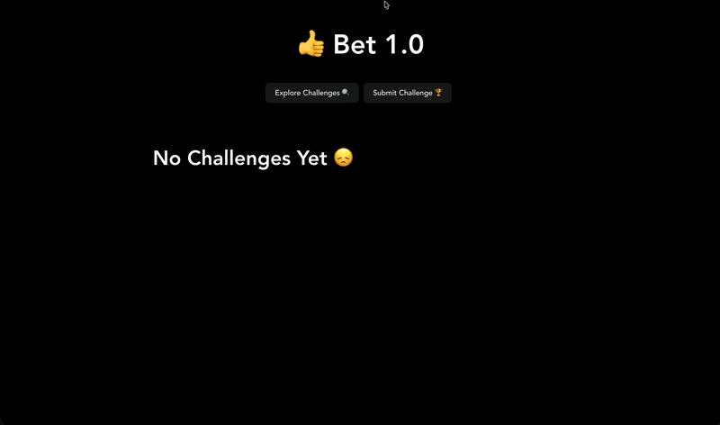

# 👍 Bet 1.0

Bet 1.0 is a small React app for browsing and submitting "challenges," such as a cartwheel in Chelsea or adopting a dog. Challenges are stored in a Supabase database and shown as cards on the home page.

## Screenshots

**Explore Challenges** (home page, lists all submitted challenges)


**Submit Challenge** (form for adding a new challenge)


## Video Walkthrough



## Features

- **Explore Challenges** (`/`): displays every challenge as a card, sorted by `id`.
- **Submit Challenge** (`/new`): a form with title, author, and description fields.
- **Edit Post** (`/edit/:id`): edit or delete an existing challenge. Open it with the "more" icon on a challenge's card.
- **Bet counter**: each card has a "👍 Bet Count" button that increments a counter.

## Tech Stack

- [React](https://react.dev/) 19 with [Vite](https://vite.dev/)
- [React Router](https://reactrouter.com/) for page routing
- [Supabase](https://supabase.com/) as the database and REST API (via `@supabase/supabase-js`)
- ESLint for linting

## Project Structure

```
src/
├── App.jsx              # Header, navigation, and route definitions
├── client.js            # Supabase client setup
├── components/
│   └── Card.jsx         # Card shown for each challenge
└── pages/
    ├── ReadPosts.jsx    # Explore Challenges page
    ├── CreatePost.jsx   # Submit Challenge page
    └── EditPost.jsx     # Edit and delete page
```

## Getting Started

### Prerequisites

- [Node.js](https://nodejs.org/) (LTS recommended)
- A Supabase project with a `Posts` table that has these columns:
  - `id` (int8, primary key)
  - `created_at` (timestamp, default `now()`)
  - `title` (text)
  - `author` (text)
  - `description` (text)
- Row Level Security policies on `Posts` that allow the `anon` role to `SELECT`, `INSERT`, `UPDATE`, and `DELETE`. Without them, Supabase rejects writes (an insert returns `401`, and updates and deletes silently affect no rows).

### Installation

```bash
git clone https://github.com/mdoran3/web102_unit7lab.git
cd web102_unit7lab
npm install
```

### Running the App

```bash
npm run dev
```

Then open the URL that Vite prints (usually `http://localhost:5173`).

### Other Scripts

| Command           | Description                  |
| ----------------- | ---------------------------- |
| `npm run build`   | Build the app for production |
| `npm run preview` | Preview the production build |
| `npm run lint`    | Run ESLint on the project    |

## Configuration

The Supabase project URL and publishable key are set in [src/client.js](./src/client.js). The publishable key is designed for client-side use, but access to your data should be controlled with Row Level Security policies on the `Posts` table.

## Known Issues

- **Edit form starts empty.** `EditPost.jsx` does not load the existing challenge into the form, so submitting without retyping every field overwrites the challenge with empty values.
- **Bet counts are not saved.** The count is local React state in `Card.jsx`, so it resets to 0 on reload and is not stored in Supabase.
- **API key is in source code.** The key is hardcoded in `client.js`. It should move to a `.env` file that is excluded from Git.
